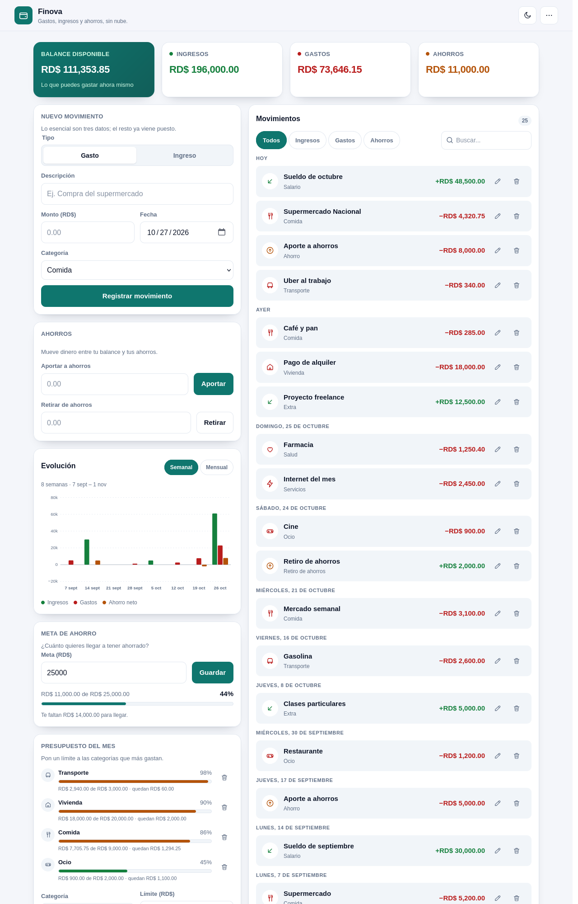

# Control de gastos

App para llevar ingresos, gastos y ahorros sin cuentas, sin nube y sin
dependencias. Son tres archivos (`index.html`, `style.css`, `script.js`) y se
abre con doble clic.



También: [modo oscuro](capturas/escritorio-oscuro.png) · [móvil](capturas/movil.png).

## Qué hace

- **Resumen**: balance disponible, ingresos, gastos y ahorros, siempre calculados
  a partir de los movimientos.
- **Movimientos**: alta con fecha y categoría, agrupados por día ("Hoy", "Ayer",
  fecha), con iconos, edición y borrado con **Deshacer**.
- **Filtros**: Todos / Ingresos / Gastos / Ahorros y búsqueda por descripción o
  categoría (ignora mayúsculas y acentos).
- **Ahorros**: aportar y retirar; cada operación queda en el historial.
- **Gráfica**: ingresos, gastos y ahorro neto de las últimas 8 semanas o los
  últimos 6 meses, en SVG propio.
- **Meta de ahorro**: cuánto quieres reunir, con barra y porcentaje.
- **Presupuesto del mes**: límite por categoría con semáforo (verde <70 %,
  ámbar 70-99 %, rojo ≥100 %).
- **Modo oscuro**: botón en la cabecera; al arrancar sigue el tema del sistema.
- **Responsive**: de 320 px a escritorio, sin desbordes.

## Cómo abrirla

### Doble clic

Abre `index.html`. Funciona, pero algunos navegadores bloquean `localStorage`
en `file://`: en ese caso verás un aviso y los datos no se conservarán al cerrar.

### Servidor local (recomendado)

```bash
cd "$HOME/Documentos/Control de gastos web  app"
python3 -m http.server 8000
```

Y entra en <http://localhost:8000>. No hace falta instalar nada más.

## Uso rápido

1. Elige **Gasto** o **Ingreso**, escribe la descripción, el monto y la
   categoría. La fecha viene con hoy; puedes cambiarla.
2. Pulsa **Registrar movimiento**. Para corregir algo, usa el lápiz de la fila;
   para eliminarlo, la papelera (el aviso permite deshacer).
3. **Ahorros**: escribe un monto y pulsa **Aportar** o **Retirar**. No se puede
   ahorrar más que el balance ni retirar más que lo ahorrado.
4. **Evolución**: alterna **Semanal** / **Mensual**. Pasa el ratón por una barra
   para ver la cifra exacta.
5. **Meta de ahorro**: escribe cuánto quieres reunir. Déjalo vacío para quitarla.
6. **Presupuesto**: elige categoría y límite; se añade a la lista. La papelera
   de cada fila elimina el límite.
7. **Tema**: el botón de luna/sol alterna claro y oscuro y recuerda la elección.

## Estructura

```
index.html      estructura, formularios y sprite de iconos SVG
style.css       tokens, temas, rejilla y componentes
script.js       estado, cálculos, render, gráfica y eventos (un solo archivo)
pruebas.html    copia de index.html que carga pruebas.js
pruebas.js      63 comprobaciones automáticas en el navegador
PLAN.md         plan por fases, decisiones y registro de progreso
backup-v1/      versión original antes del rediseño
capturas/       capturas de referencia (escritorio, móvil, oscuro)
```

## Datos

Todo se guarda en el navegador:

| Clave | Contenido |
|---|---|
| `finance-app-estado` | `{ version: 2, movimientos, metaAhorro, presupuestos }` |
| `finance-app-tema` | `auto` \| `claro` \| `oscuro` |
| `finance-app-estado-v1-backup` | copia del formato viejo, solo si hubo migración |

Los totales nunca se guardan: se derivan de los movimientos.

```
ahorros = aportes − retiros
balance = ingresos − gastos − ahorros
```

Para empezar de cero: menú **⋯ → Borrar todos los datos** (pide confirmación).

## Pruebas

`pruebas.html` ejecuta la batería sobre la app real y muestra cada línea con
`OK` o `FALLO`. Respalda y restaura tus datos, así que puedes abrirla sin miedo.

```bash
# Si cambias index.html, regenera la copia de pruebas
cp index.html pruebas.html
sed -i 's#</body>#<script src="pruebas.js"></script>\n</body>#' pruebas.html
```

Con el servidor local en marcha, abre
<http://localhost:8000/pruebas.html>. También se puede comprobar sin interfaz:

```bash
rm -rf /tmp/ffperfil && mkdir -p /tmp/ffperfil
firefox --headless -profile /tmp/ffperfil --window-size=1280,1750 \
  --screenshot=/tmp/pruebas.png "http://localhost:8000/pruebas.html"
```

La captura debe mostrar 63 líneas, todas con `OK`.

## Accesibilidad

- Un solo `h1`, landmarks y enlace "Saltar al contenido".
- Formularios con `<label>`; botones de icono con `aria-label`.
- Foco visible con `:focus-visible`; sin `tabindex` positivos.
- `aria-live` en el resumen y en los avisos; `aria-pressed` en tema y filtros.
- Contraste AA en ambos temas y respeto por `prefers-reduced-motion`.

## Volver a la versión anterior

La versión vieja usa **la misma clave** (`finance-app-estado`) pero con otro
formato. Si restauras los archivos sin más, la app vieja leerá los datos nuevos
como si estuvieran vacíos y los sobrescribirá al guardar.

Antes de volver atrás, guarda una copia. Con la app nueva abierta, en la consola
del navegador:

```js
copy(localStorage.getItem("finance-app-estado"));
```

Pega el resultado en un archivo de texto. Después:

```bash
cp backup-v1/index.html backup-v1/style.css backup-v1/script.js .
```

Para regresar a la versión nueva, pega esa copia en `finance-app-estado` y
recarga: si es formato v1, la migración la convierte; si ya es v2, se usa tal
cual. Si la copia no existe, la app nueva arrancará vacía (los datos viejos no
se pueden reconstruir).

## Sin dependencias

No hay librerías, build ni servicios de pago. La gráfica y los iconos son SVG
generados a mano. Solo se necesita un navegador moderno y, opcionalmente,
`python3` para servir la carpeta.
