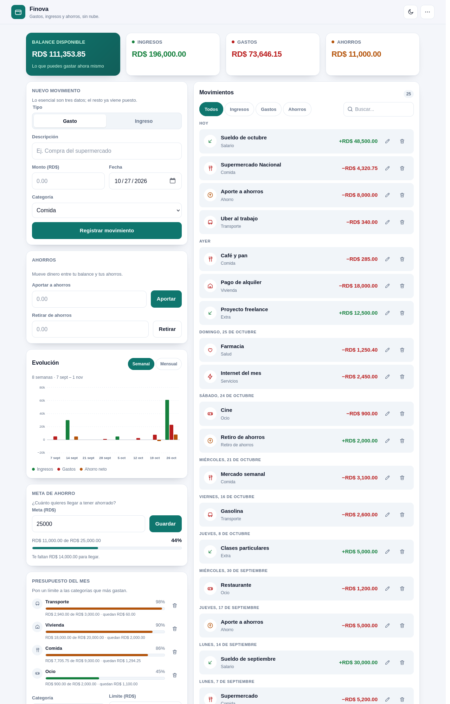

# Finova

**Gastos, ingresos y ahorros del día a día, sin cuentas ni nube.**




También: [modo oscuro](capturas/escritorio-oscuro.png) · [móvil](capturas/movil.png).

## ¿Por qué Finova?

Apuntar los gastos suele terminar en apps que piden cuenta, conexión y
permisos, o en hojas de cálculo que nadie actualiza. Finova es lo contrario:
se abre y funciona. Todo lo que escribes **se queda en tu navegador**; no hay
servidores, registro ni telemetría de ningún tipo.

Está pensada para cualquier persona que solo quiera responder tres preguntas
cada día: *cuánto entra, cuánto gasto y cuánto me queda*. Suficientemente
sencilla para usar con prisa, y suficientemente completa para presupuestos por
categoría, meta de ahorro y gráfica de evolución.

## La app, publicada

El código está publicado en
[github.com/fdargenis/control-gastos](https://github.com/fdargenis/control-gastos).
Para probarla sin instalar nada más, clona el repositorio y abre `index.html`
(el navegador la ejecuta directamente).

## Empezar

```bash
git clone https://github.com/fdargenis/control-gastos.git
cd control-gastos
```

Abre `index.html` con doble clic o sírvelo con la extensión **Live Server** de
VS Code (o con cualquier servidor estático, como `npx serve`). Para que los
datos se conserven entre visitas conviene usar un servidor local: algunos
navegadores bloquean el almacenamiento al abrir el archivo directamente
(`file://`) y avisarán.

## Qué hace

- **Resumen**: balance disponible, ingresos, gastos y ahorros, siempre calculados
  a partir de los movimientos.
- **Saldo inicial**: indica el dinero que ya tenías antes de empezar; se suma al
  balance y viaja en la copia de seguridad.
- **Movimientos**: alta con fecha y categoría, agrupados por día ("Hoy", "Ayer",
  fecha), con iconos, edición y borrado con **Deshacer**.
- **Copia de seguridad**: exporta todo a un archivo JSON y lo importa de nuevo,
  con confirmación y **Deshacer**.
- **Filtros y búsqueda**: Todos / Ingresos / Gastos / Ahorros, y buscador que
  ignora mayúsculas y acentos.
- **Ahorros**: aportar y retirar; cada operación queda en el historial.
- **Gráfica**: ingresos, gastos y ahorro neto de las últimas 8 semanas o los
  últimos 6 meses, dibujada en SVG propio.
- **Meta de ahorro**: cuánto quieres reunir, con barra y porcentaje.
- **Presupuesto del mes**: límites por categoría con semáforo (verde <70 %,
  ámbar 70-99 %, rojo ≥100 %).
- **Modo oscuro**: botón en la cabecera; al arrancar sigue el tema del sistema.

## Uso rápido

1. Elige **Gasto** o **Ingreso**, escribe la descripción, el monto y la
   categoría. La fecha viene con hoy; puedes cambiarla. Si ya tenías dinero,
   guárdalo antes en **Saldo inicial**.
2. Pulsa **Registrar movimiento**. Para corregir algo, usa el lápiz de la fila;
   para eliminarlo, la papelera (el aviso permite **Deshacer**).
3. **Ahorros**: escribe un monto y pulsa **Aportar** o **Retirar**. No se puede
   ahorrar más que el balance ni retirar más que lo ahorrado.
4. **Evolución**: alterna **Semanal / Mensual**. Pasa el ratón por una barra
   para ver la cifra exacta.
5. **Meta de ahorro**: escribe cuánto quieres reunir; déjalo vacío para quitarla.
6. **Presupuesto**: elige categoría y límite; la papelera de cada fila lo
   elimina.
7. **Tema**: el botón de luna/sol alterna claro y oscuro y recuerda la elección.
8. **Copia de seguridad**: en el menú `⋯` de la cabecera, **Exportar copia**
   descarga `finova-copia-<fecha>.json`; **Importar copia…** muestra un resumen
   y pide confirmación antes de reemplazar, y el aviso ofrece **Deshacer**.

## Tecnologías

| Tecnología | Papel en el proyecto |
|---|---|
| **HTML5** | Estructura de la app y sprite de iconos SVG, semántica accesible |
| **CSS3** | Tokens de color, modo oscuro, rejilla responsive (320 px → escritorio) |
| **JavaScript** | Lógica, estado, gráfica y batería de pruebas; vanilla, sin módulos ni framework |

No hay librerías externas, ni paso de build, ni servicios de pago: la gráfica y
los iconos son SVG escritos a mano.

## Estructura del proyecto

```
index.html            estructura, formularios y sprite de iconos SVG
style.css             tokens, temas, rejilla y componentes
script.js             estado, cálculos, render, gráfica y eventos
pruebas.html          copia de index.html que carga las pruebas
pruebas.js            90 comprobaciones automáticas en el navegador
docs/TECNICA.md       documentación técnica avanzada
PLAN.md               memoria del diseño por fases
capturas/             imágenes usadas en este README
LICENSE               licencia MIT
backup-v1/            copia local de la versión original (no versionada)
```

## Hoja de ruta

**Terminado (v1)**

- [x] Dashboard de tarjetas con balance, ingresos, gastos y ahorros.
- [x] Alta, edición y borrado con deshacer; agrupación por día.
- [x] Filtros, búsqueda y contador de resultados.
- [x] Aportes y retiros de ahorros con validación.
- [x] Gráfica SVG semanal (8 semanas) y mensual (6 meses).
- [x] Meta de ahorro con progreso.
- [x] Presupuesto mensual por categoría con semáforo.
- [x] Modo oscuro, responsive y accesibilidad AA revisada.
- [x] Batería automática de 90 comprobaciones (creció con cada fase).

**Pendiente (ideas para la v2)**

- [x] Copia de seguridad: exportar/importar movimientos a JSON — **entregada**
  (exporta `finova-copia-<fecha>.json`; la importación valida, pide confirmación
  y permite deshacer).
- [x] Saldo inicial configurable — **entregado** (se suma al balance y viaja en
  la copia JSON).
- [ ] Exportar los movimientos a CSV (Excel/Sheets).
- [ ] Movimientos recurrentes (alquiler, sueldo…).
- [ ] Instalable en móvil (PWA) y demo persistente en GitHub Pages.

## Datos y privacidad

Todo funciona y se guarda en el navegador (`localStorage`): nada viaja a
ningún servidor. El esquema completo de datos, las reglas de cálculo y los
detalles de la gráfica están en la
[documentación técnica](docs/TECNICA.md).

## Licencia

Distribuido bajo la
[licencia MIT](LICENSE): puedes usar, copiar y modificar el código
indicando la autoría original.
